<h1 align="center">🍔 Loqma · لُقمة</h1>

<p align="center">
  A food-delivery app built with <b>Flutter</b> on a real <b>NestJS</b> backend.<br/>
  Browse restaurants, customize your meal and manage your cart, in <b>Arabic</b> or <b>English</b>.
</p>

<p align="center">
  
  
  
  
  
  
</p>

<p align="center">
  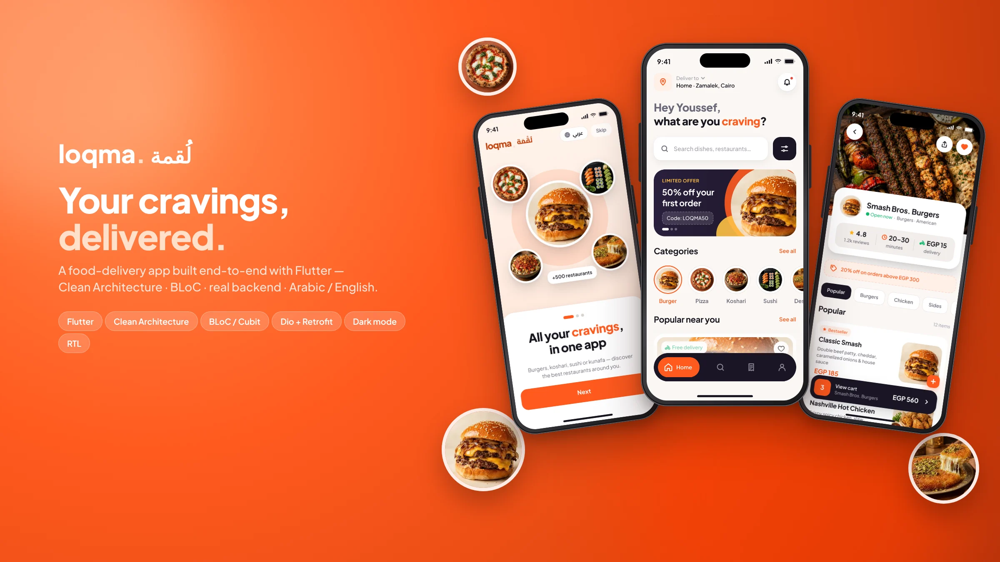
</p>

## ✨ Features

- 🚀 **Onboarding & splash**: a native splash plus a 3-step onboarding, with a language switch right on the first screen.
- 🔐 **Auth**: register and log in with **access / refresh tokens**. Tokens live in secure storage, and an **auth interceptor** refreshes them automatically when they expire.
- 🏠 **Home**: promo banners, categories, *Popular near you*, *Top rated* and *Trending now*, all loaded from the API.
- 🍽️ **Restaurant details**: rating, delivery time and fee, plus a menu grouped into sections with quick-jump tabs.
- 🧩 **Dish customization**: required and optional option groups (size, extras, spice level) with min/max rules, a live price and special instructions.
- 🛒 **Server-side cart**: add, update quantity and remove items, with subtotal, delivery fee and total calculated by the backend. A floating *View cart* bar shows the running total.
- 🌍 **Arabic / English**: full RTL support, plus a language interceptor that sends `Accept-Language`, so API content comes back localized too.
- ⚠️ **Error handling**: typed failures (`Either<Failure, T>`) with friendly dialogs, e.g. *No connection → Try again*.

<p align="center">
  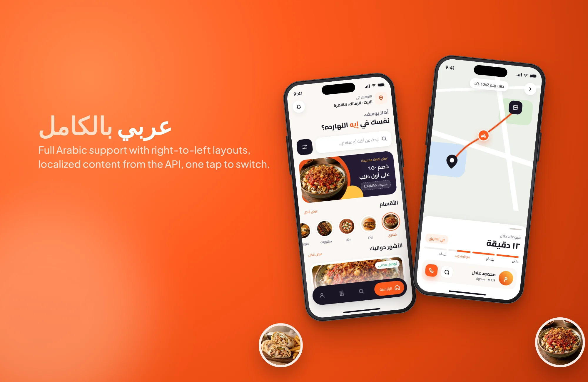
</p>

## 🎨 Design

Every screen was designed first in **Figma** on a token-based design system (light & dark color modes, spacing, radius, typography), then built in Flutter.

<p align="center">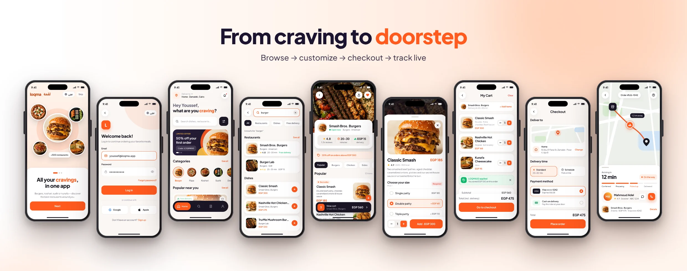</p>
<p align="center">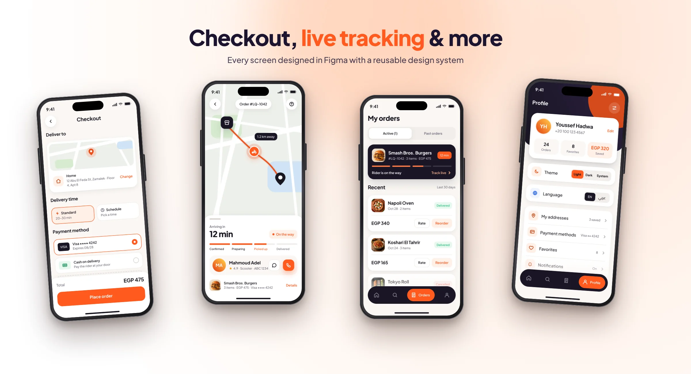</p>
<p align="center">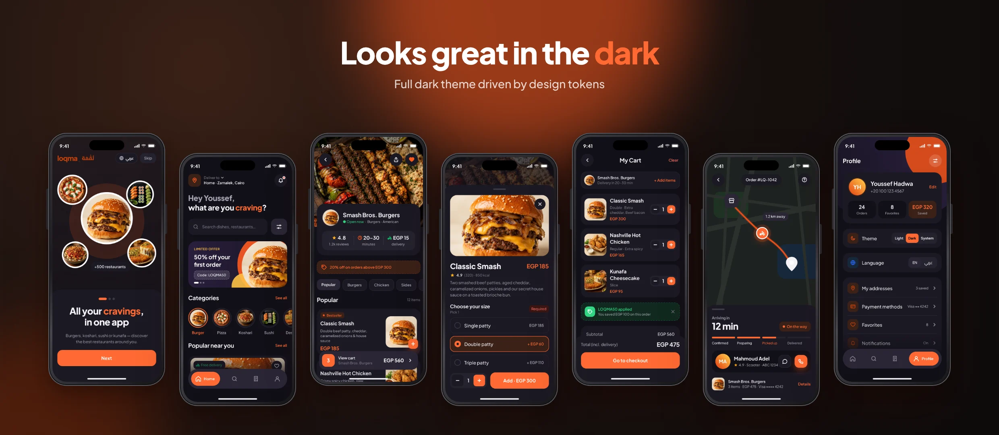</p>
<p align="center">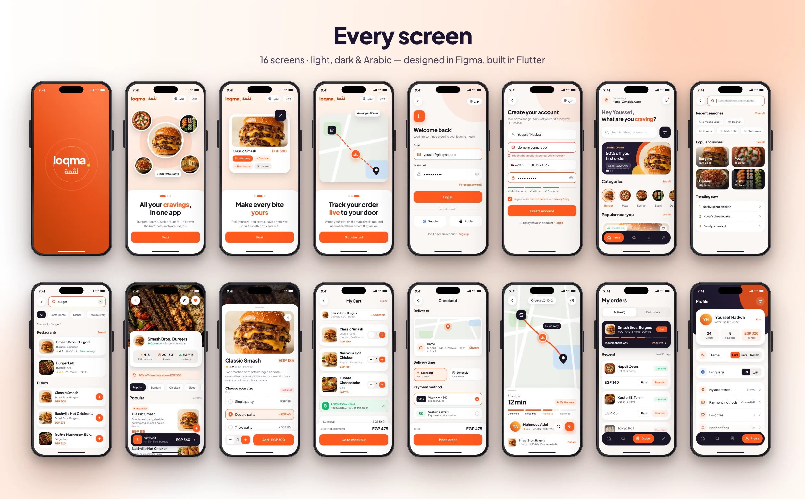</p>

## 📱 Running app

Real screenshots from the Flutter app running against the backend:

<p align="center">
  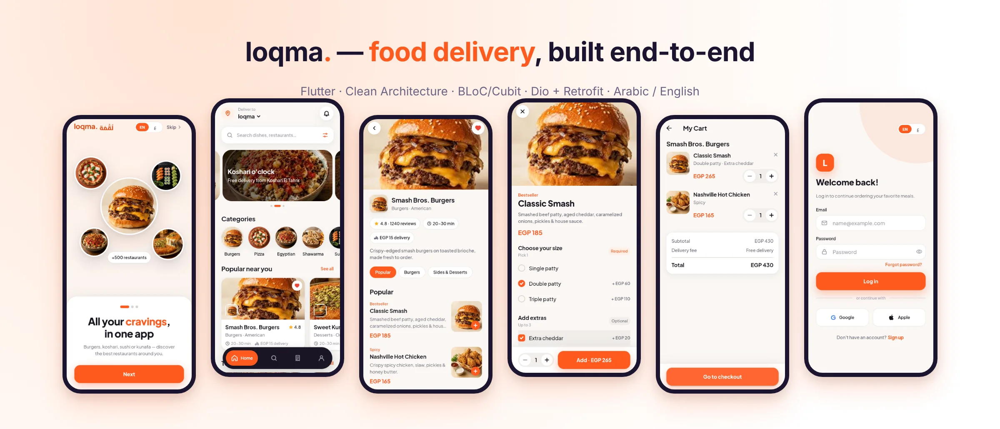
</p>

| Onboarding | Login | Home | Restaurant |
|:-:|:-:|:-:|:-:|
| 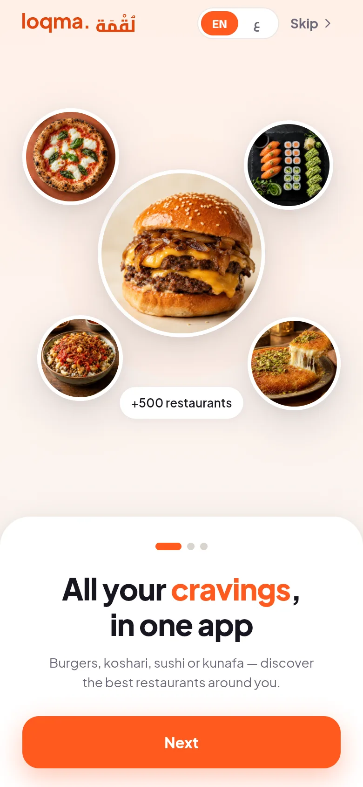 | 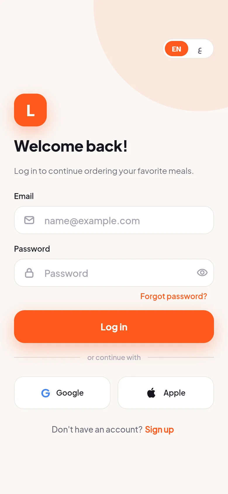 | 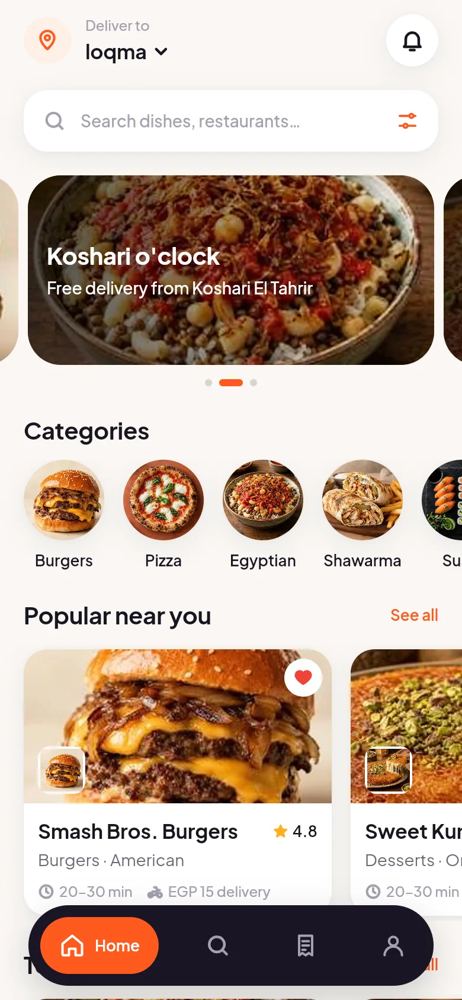 | 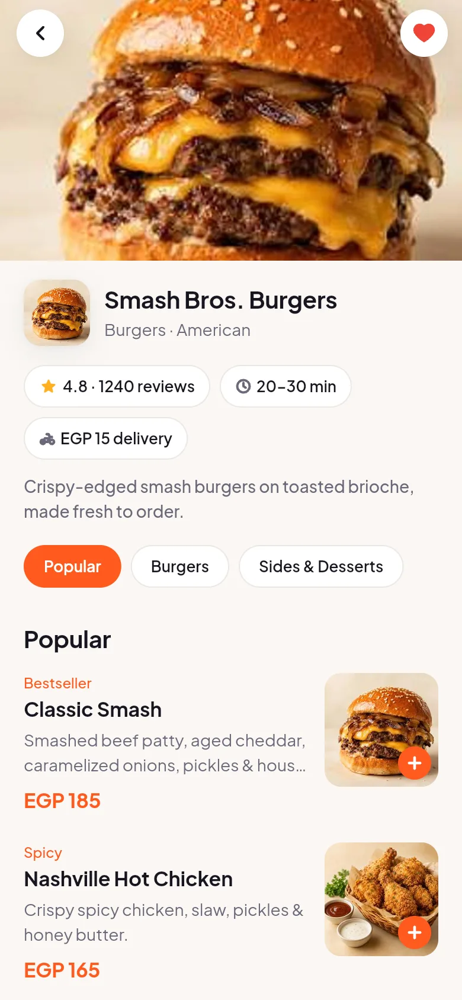 |
| **Customize dish** | **Options & rules** | **Cart** | **عربي** |
| 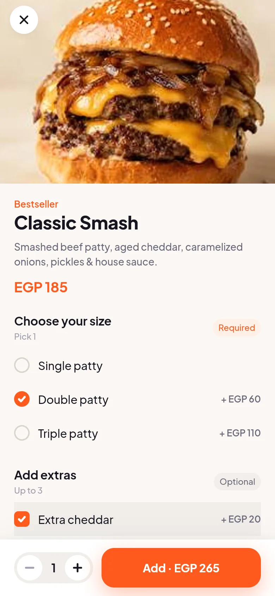 | 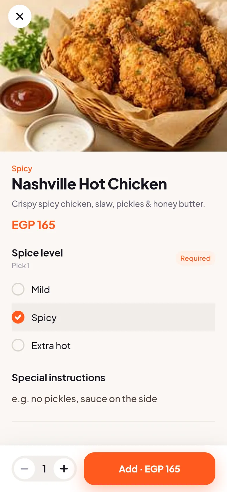 | 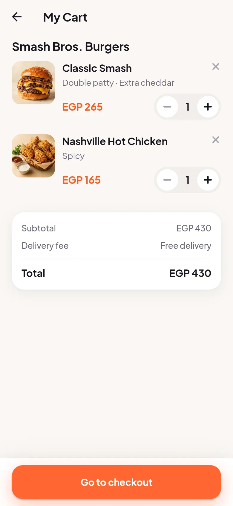 | 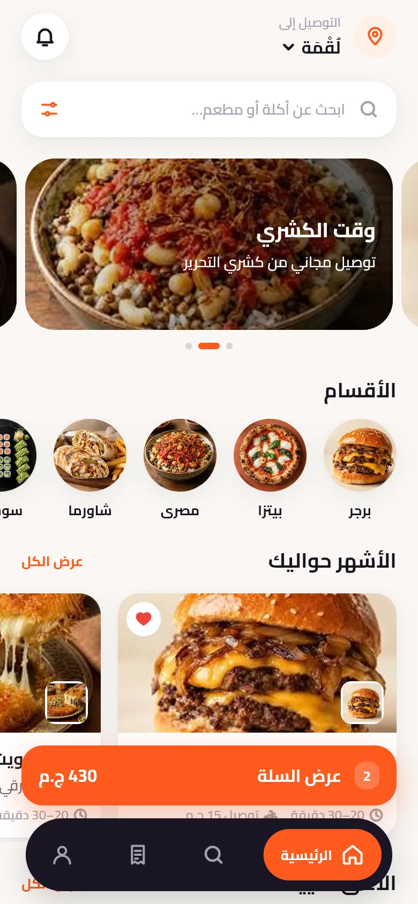 |

## 🏗️ Architecture

The app follows **Clean Architecture**, organized feature-first. Each feature is split into three layers, and dependencies only point inward.

```
lib/
├── core/
│   ├── di/              # get_it service locator
│   ├── network/         # Dio client + interceptors (auth / refresh token, language)
│   ├── error/           # Failure types & error mapping
│   ├── router/          # go_router routes & custom transitions
│   ├── localization/    # AR / EN + RTL
│   ├── theme/ widgets/  # design system & reusable widgets
│   └── utils/cache/     # secure storage / shared preferences helper
└── features/
    ├── auth/            # data · domain · presentation
    ├── home/
    ├── restaurants/
    ├── cart/
    ├── onboarding/
    └── splash/
```

| Layer | Contains |
|---|---|
| **presentation** | pages, widgets and **Cubits**: the UI only reacts to states |
| **domain** | entities, repository contracts and **use cases**: pure Dart, no Flutter |
| **data** | Retrofit API services, `freezed` / `json_serializable` models, repository implementations |

These principles apply throughout:

- **SOLID**: every dependency is injected through an abstraction (`get_it`), so any layer can be tested or swapped.
- **One source of truth**: the cart and its prices are calculated by the backend, never on the device.
- More details are in [`docs/ARCHITECTURE.md`](docs/ARCHITECTURE.md).

## 🧰 Tech stack

| | |
|---|---|
| **State management** | `flutter_bloc` (Cubit) |
| **Networking** | `dio`, `retrofit`, `pretty_dio_logger` |
| **Models** | `freezed`, `json_serializable`, `dartz` (Either) |
| **DI & routing** | `get_it`, `go_router` |
| **Storage** | `flutter_secure_storage` (tokens), `shared_preferences` |
| **UI** | `flutter_screenutil`, `cached_network_image`, `google_fonts`, `flutter_svg` |
| **Localization** | `intl`, `flutter_localizations` (AR / EN, RTL) |
| **Backend** | NestJS · Prisma · PostgreSQL · Socket.IO |

## 🚀 Run it

**1. Start the backend** (a separate NestJS + PostgreSQL project, `loqma-api`):

```bash
cd loqma-api
npm install
npm run local        # starts an embedded Postgres, seeds demo data, runs the API on :3000
```

**2. Run the app**. First set your machine's IP in `lib/core/constants/api_constants.dart`:

```dart
static const String baseUrl = 'http://<your-ip>:3000/api/v1';
```

```bash
flutter pub get
dart run build_runner build --delete-conflicting-outputs
flutter run
```

**Demo account:** `demo@loqma.app` / `Passw0rd!`

## 🗺️ Roadmap

- [x] Onboarding, auth with token refresh, home, restaurant, dish customization, cart
- [ ] Checkout & promo codes
- [ ] Live order tracking (Socket.IO, rider on the map)
- [ ] Orders history & profile

---

<p align="center">Made with ❤️ by <a href="https://github.com/youssef-hossam">Youssef Hadwa</a></p>
